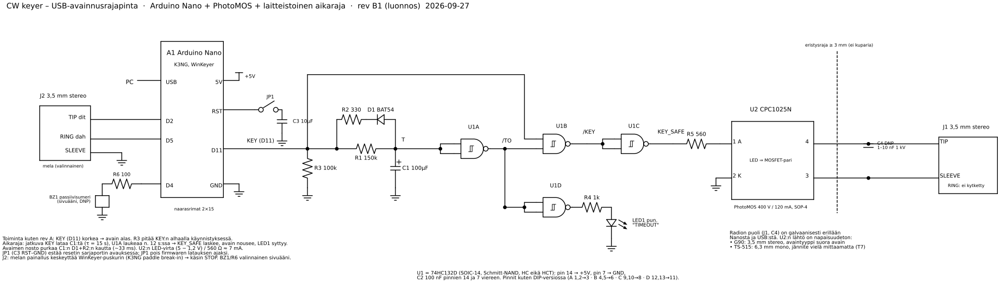
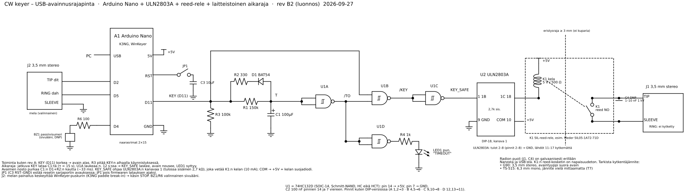

# Rev B – USB-avainnusrajapinta (luonnos, kaksi vaihtoehtoa)

Rev B luonnos · 2026-09-27 · jatkoa M0-protolle (`M0-proto.md`, rev A). Tavoitteena edullinen USB-keyer omalle piirilevylle. Levy tehdään koulun piirilevyjyrsimellä, ja pintaliitososat juotetaan reflow-uunissa.

Lähtöasteesta on kaksi vaihtoehtoa. Muu kytkentä on molemmissa sama.

| | **B1 PhotoMOS** | **B2 ULN2803A + reed-rele** |
| --- | --- | --- |
| Lähtö | U2 CPC1025N (SOP-4) + R5 | U2 ULN2803A (DIP-18, varastossa) + K1 5 V SIL-reed-rele |
| Eristys radiosta | Kyllä | Kyllä |
| Napaisuus | Kumpikin | Kumpikin |
| Jännite / virta | 400 V / 120 mA | Releen mukaan, esim. SIL05: tarkista datalehdestä (≥ 150 V TS-515:lle) |
| Päällä-resistanssi | Kymmeniä ohmeja | Alle 0,2 Ω |
| Kuluminen, nopeus | Ei kulu, noin ms:n viive | Reed kestää kymmeniä–satoja miljoonia kytkentöjä, alle 1 ms:n viive, pieni naksahdus |
| Uunijuotettavaa | Enemmän (U2 SOP-4) | Vähemmän (U2 ja K1 läpiladottavia) |
| Hinta lähtöasteelle | Noin 2 € | Noin 1 € (ULN varastossa) |

Lähde: `schematic_revb.py` (schemdraw). `python schematic_revb.py` → B1 (`cw-keyer-revb.*`), `python schematic_revb.py reed` → B2 (`cw-keyer-revb-reed.*`).

## 1. Mikä muuttuu rev A:sta

| Rev A (kytkentälevy) | Rev B | Miksi |
| --- | --- | --- |
| 5 V relemoduuli + JP2 | B1: PhotoMOS · B2: ULN2803A + reed-rele | Eristys ja napaisuudeton lähtö levylle ilman moduulia. Kuivan kontaktin ongelma (G90) poistuu kummassakin. |
| 74HC132 DIP-14 | 74HC132D SOIC-14 | Uunijuotos. Pinnijärjestys on sama. |
| 1/4 W -vastukset, BAT85, THT-kondensaattorit | 0805-passiivit, BAT54 (SOT-23), SMD-elko | Uunijuotos |
| – | **J2** melajakki D2/D5 (valinnainen) | Melan painallus keskeyttää WinKeyer-puskurin (K3NG paddle break-in), eli käsikäyttöinen STOP (SR-04). Toimii myös käsiavaimena. |
| – | **BZ1 + R6** sivuääni D4:ssä (valinnainen, DNP) | Testaus ilman radiota |
| – | **C4** RF-suodatus J1:lle (DNP) | Paikka valmiina, asennetaan vain, jos RF-ongelmia ilmenee. |

Ennallaan: Arduino Nano irrotettavana moduulina (USB ja CH340 moduulissa, joten USB-liitintä ei tarvitse jyrsiä), K3NG-firmware, KEY = D11 aktiivinen korkea, R3-alasveto, laitteistoinen aikaraja noin 12 s ja JP1/C3-resetin esto.

## 2. Lähtöaste

### B1 – PhotoMOS CPC1025N

- LED-virta KEY_SAFEsta R5:n kautta: (5 − 1,2 V) / 560 Ω ≈ 7 mA, mikä on selvästi yli datalehden aktivointivirran ja reilusti alle maksimin. U1C jaksaa ajaa sen suoraan.
- Päällä-resistanssi on kymmeniä ohmeja. Se ei haittaa G90:n muutaman voltin avainlinjaa eikä muutaman mA:n estojänniteavainnusta.
- Jos TS-515 osoittautuu katodiavainnetuksi ja avainvirta ylittää 120 mA, CPC1025N ei riitä → B2 tai suuremman virran PhotoMOS.

### B2 – ULN2803A + reed-rele

- KEY_SAFE → ULN2803A:n kanava 1 (pinni 1, 1B). Tulossa on sisäinen 2,7 kΩ:n sarjavastus, joten 5 V:n HC-lähtö käy suoraan ja virta on noin 1,3 mA.
- Lähtö 1C (pinni 18) vetää K1:n kelan maahan. Kela 500 Ω → noin 10 mA.
- COM (pinni 10) → +5V, jolloin ULN:n sisäinen diodi vaimentaa kelan jännitepiikin. Jos releessä on oma diodi (SIL05-…-71D), kela on napaisuusherkkä: releen +-pinni +5V:iin.
- GND (pinni 9) → GND. Käyttämättömät tulot 2–8 (pinnit 2–8) → GND ja lähdöt 11–17 kytkemättä.
- Reed-kosketin on eristetty ja napaisuudeton, ja se sopii myös G90:n kuivalle, pienivirtaiselle linjalle. **Tarkista releen kytkentäjännite datalehdestä** ennen TS-515:tä: jos avainlinjassa on −60…−120 V, releen pitää kestää vähintään noin 150 V DC.
- **Miksi ei ULN suoraan radioon:** eristys katoaisi (radion runko = USB-maa), lähtö kestää vain 50 V, negatiivinen avainjännite saisi sisäisen diodin johtamaan (avain jumissa alhaalla), ja Darlingtonin jäännösjännite on noin 0,7–0,9 V.

## 3. Osaluettelo (BOM)

Hinnat ovat suuntaa-antavia yksittäiskappalehintoja. Tarkista ne toimittajalta (esim. LCSC, Mouser, DigiKey, Partco) ennen tilausta.

### Yhteiset osat

| Ref | Osa | Kotelo | Kpl | Huomiot | n. € |
| --- | --- | --- | --- | --- | --- |
| A1 | Arduino Nano -klooni (CH340) | moduuli | 1 | Rev A:n Nano käy. | 3–5 |
| – | Naarasrima 1×15, 2,54 mm | THT | 2 | Nano irrotettavaksi | 0,3 |
| U1 | 74HC132D | SOIC-14 | 1 | **HC**, ei HCT | 0,3 |
| R1 | 150 kΩ 1 % | 0805 | 1 | Aikarajan säätö (T3), varaa myös 180k ja 200k | 0,05 |
| R2 | 330 Ω | 0805 | 1 | | 0,02 |
| R3 | 100 kΩ | 0805 | 1 | KEY-alasveto | 0,02 |
| R4 | 1 kΩ | 0805 | 1 | LED1 | 0,02 |
| R6 | 100 Ω | 0805 | 1 | Sivuääni, DNP | 0,02 |
| C1 | 100 µF 16–25 V alumiinielko | SMD 6,3×5,4 mm | 1 | Reflow-kelpoinen, pieni vuotovirta | 0,2 |
| C2 | 100 nF X7R | 0805 | 1 | U1:n käyttöjännitteen suodatus | 0,02 |
| C3 | 10 µF 16 V X5R | 0805 | 1 | Resetin esto | 0,05 |
| C4 | 1–10 nF 1 kV | 1206 | 0 | DNP, RF-suodatus | – |
| D1 | BAT54 | SOT-23 | 1 | Pinni 1 = anodi (C1+), pinni 3 = katodi (R2) | 0,05 |
| LED1 | Punainen LED | 0805 | 1 | TIMEOUT | 0,05 |
| JP1 | Piikkirima 1×2 + jumpperi | THT | 1 | | 0,1 |
| J1 | 3,5 mm stereojakki, piirilevy | THT (PJ-307 tms.) | 1 | Avainlähtö | 0,3 |
| J2 | 3,5 mm stereojakki, piirilevy | THT | 1 | Mela, valinnainen | 0,3 |
| BZ1 | Passiivinen summeri 12 mm | THT | 0 | DNP | 0,3 |
| – | Kuparilaminaatti FR-4, 1-puolinen, n. 60 × 50 mm | | 1 | Koululta | – |
| – | Kaapelit: 3,5 stereo–3,5 stereo (G90), 3,5 → 6,3 mono (TS-515) | | | Rev A:sta | – |

### B1 – lisäksi

| Ref | Osa | Kotelo | Kpl | Huomiot | n. € |
| --- | --- | --- | --- | --- | --- |
| U2 | CPC1025N | SOP-4 | 1 | PhotoMOS 400 V / 120 mA | 1,5–2,5 |
| R5 | 560 Ω | 0805 | 1 | U2:n LED-virta | 0,02 |

### B2 – lisäksi

| Ref | Osa | Kotelo | Kpl | Huomiot | n. € |
| --- | --- | --- | --- | --- | --- |
| U2 | ULN2803A | DIP-18 (THT) | 1 | Varastossa. Kanava 1 käytössä. | – |
| – | IC-kanta 18-pin (valinnainen) | THT | 1 | | 0,2 |
| K1 | 5 V SIL-reed-rele, 1 × NO, kela noin 500 Ω | SIP-4 | 1 | Esim. Meder SIL05-1A72-71D. **Tarkista kytkentäjännite** (≥ 150 V DC TS-515:lle) ja pinnijärjestys datalehdestä. | 1–2 |

**Yhteensä noin 6–9 € Nanon kanssa** kummassakin vaihtoehdossa. Ilman Nanoa noin 2–3 €.

## 4. Levysuunnittelu jyrsimelle

- **Yksipuolinen levy.** Pintaliitososat kuparipuolelle ja läpiladottavat (rimat, jakit, JP1, B2:ssa ULN2803A ja K1) toiselle puolelle, jolloin niiden juotos tehdään kuparipuolelta. Läpiladottavien reiät porataan joka tapauksessa.
- Jos yksipuolinen reititys ei onnistu, käytä hyppyjä 0 Ω 1206 -vastuksina. Ne ovat hyvää harjoitusta uunille. DIP-18:n pinnien välistä mahtuu yleensä yksi 0,4 mm:n veto.
- **Vedot ja välit:** esim. 0,4 mm:n vedot ja 0,3–0,4 mm:n eristysvälit, tai koulun terän mukaan. Käytä maapintaa, mutta jätä **J1 ja lähtöpuoli (B1: U2 pinnit 3–4 · B2: K1:n kosketinpinnit) sekä C4 kokonaan maapinnan ulkopuolelle** ja jyrsi eristysrajaan ≥ 3 mm:n kupariton rako. Radion runko ei saa yhdistyä USB-maahan. B2:ssa raja kulkee K1:n kela- ja kosketinpinnien välistä.
- C2 aivan U1:n pinnien 14 ja 7 viereen.
- C1 ja R1 kauas lämmönlähteistä, ja R1 paikkaan, josta sen voi vaihtaa kolvilla (säätö).
- Juotoseristettä ei ole, joten tahnaa annostellaan niukasti. SOIC-14:n siltoja voi poistaa imunauhalla.
- Kiinnitysreiät M3 kulmiin. Kotelo myöhemmin.

## 5. Firmware

Sama kuin rev A:ssa (`M0-proto.md` luku 4) molemmissa vaihtoehdoissa. K3NG:n oletuspinnit riittävät: dit D2, dah D5, sivuääni D4, `tx_key_line_1` D11. `tx_key_line_active_state HIGH`, älä käännä.

## 6. Testit

Rev A:n testit T1–T8 sellaisenaan, sillä relekohdat tarkoittavat nyt U2:ta (B1) tai K1:tä (B2). B1:ssä J1 kiinni mitataan ohmialueella kymmeninä ohmeina, ei 0 Ω:na. Lisäksi:

| # | Testi | Hyväksytty kun |
| --- | --- | --- |
| T9 | Eristys | Yleismittari ohmialueella J1 SLEEVE ↔ Nanon GND ja J1 TIP ↔ GND: katkos (> 10 MΩ) |
| T10 | Mela-STOP | `wk_test.py COMx send` pitkä teksti, melan painallus kesken: lähetys katkeaa, eikä puskurin loppua lähetetä. |
| T11 | Levyn silmämääräinen tarkastus ennen virtaa | Ei siltoja U1:ssä ja U2:ssa. D1:n, C1:n, LED1:n ja (B2) K1:n suunta oikein. 5V–GND-resistanssi ei ole oikosulku. |

## 7. Avoimet asiat

- TS-515:n avainjännite ja -virta (T7) ratkaisevat, riittääkö CPC1025N (B1) ja mikä reed-rele valitaan (B2).
- K3NG:n käytös melan painalluksessa WinKeyer-tilassa (T10). Jos se ei tyhjennä puskuria, STOP-painikkeelle tarvitaan muu ratkaisu.
- Vaihtoehdon valinta (B1/B2) ja levyn piirtäminen, esim. KiCadissa.
